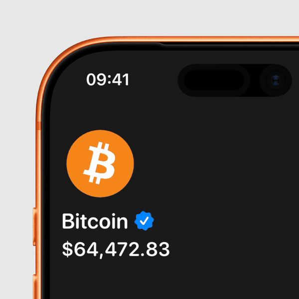

# Coin Spin

A 3D coin that spins when you tap it, with a textured face and a colored edge. Built with SceneKit inside SwiftUI.



## Example

```swift
CoinSpin(imageName: "Bitcoin", edgeColor: .orange, spinTrigger: spinTrigger)
    .frame(width: 80, height: 80)
    .onTapGesture { spinTrigger += 1 }
```
